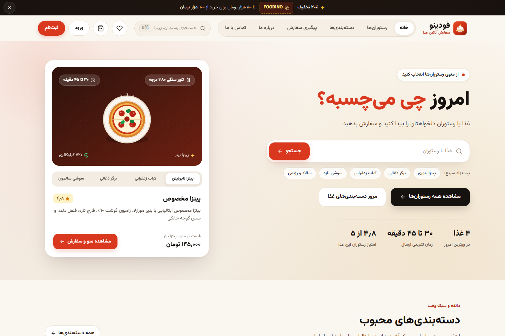
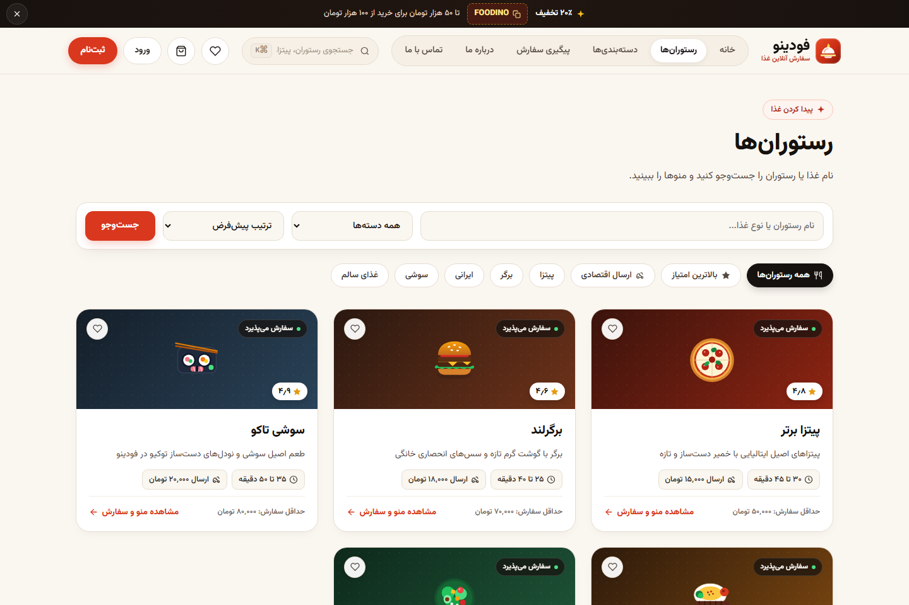
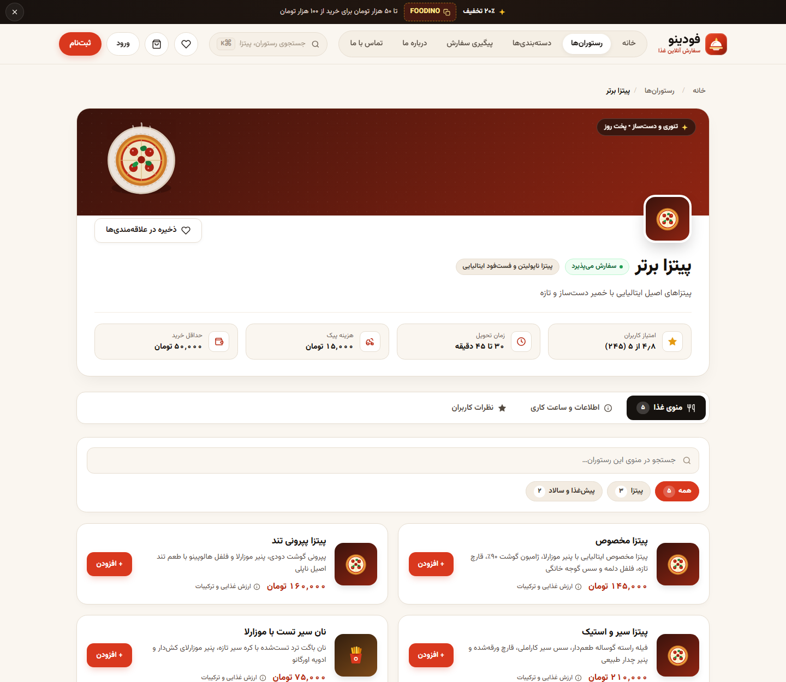
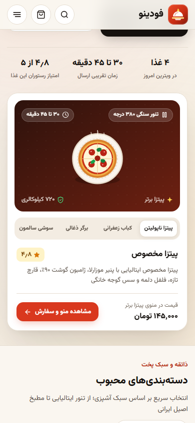
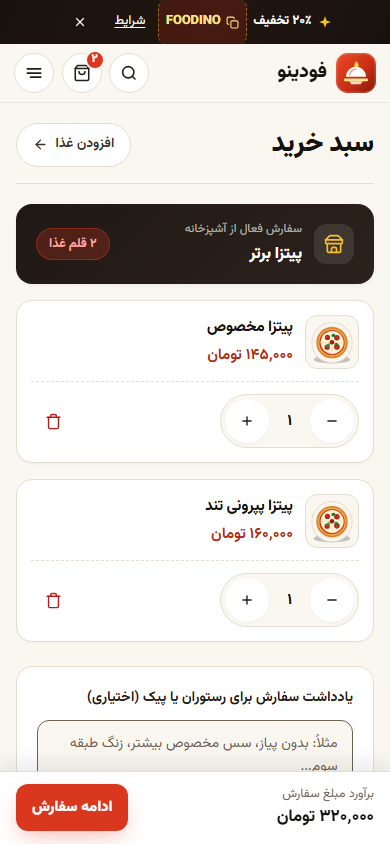
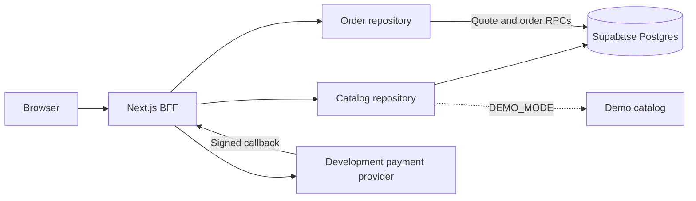

<p align="center">
  <a href="https://foodino-online-food-ordering-platfo-kohl.vercel.app/">
    
  </a>
</p>

<h1 align="center">Foodino</h1>

<p align="center">
  <strong>Find your favorite meal, place your order, and follow it to your door.</strong>
</p>

<p align="center">
  <a href="https://foodino-online-food-ordering-platfo-kohl.vercel.app/">
    
  </a>
</p>

<p align="center">
  <a href="https://nextjs.org/">
    
  </a>
  <a href="https://www.typescriptlang.org/">
    
  </a>
</p>

<p align="center">
  <a href="README.md">فارسی</a> · <a href="#quickstart">Run locally</a> · <a href="#architecture">Architecture</a>
</p>



## The ordering experience

- **Find a meal:** search restaurant names and menu items, get search suggestions, filter by category, and sort by rating or delivery fee.
- **Choose from a menu:** inspect descriptions and prices, select variants and add-ons, adjust quantities, and add item notes. The food details dialog supports keyboard navigation.
- **One restaurant per cart:** keep the cart in the browser, manage quantities, add an order note, and apply a coupon. Adding from another restaurant is rejected until the cart is cleared.
- **Customer account:** sign in, recover a password, manage delivery addresses, revisit orders, and save restaurants. Favorite removal is confirmed after successful persistence.
- **Order tracking:** follow preparation and delivery through a tracking code. Requests stop for missing orders and terminal states.
- **Desktop and touch interaction:** an interactive food showcase, scroll reveals, hover and press feedback, keyboard focus, and reduced-motion support.

### A closer look

<details>
<summary>Restaurant discovery and the ordering menu</summary>

Restaurant search and filters:



Restaurant details, menu search, and food selection:



</details>

| Mobile food showcase | Mobile cart |
| --- | --- |
|  |  |

<a id="quickstart"></a>

## Run locally

Both paths require **Node.js 24.x** and **npm 11.x**, as specified in [package.json](package.json). Dependency versions are pinned in [package-lock.json](package-lock.json).

```bash
git clone https://github.com/Pezhm4n/Foodino---Online-Food-Ordering-Platform.git foodino
cd foodino
npm ci
```

### 1. Explore the interface without Docker

Use this path for the catalog, search, showcase, and browser cart. Authentication, persistent orders, and the complete payment flow require actual services. Prices, reviews, and nutrition information in this mode are sample data.

If `.env.local` already exists, do not overwrite it with the copy command. Reconcile the required settings with [.env.example](.env.example) instead.

**PowerShell**, from the repository root:

```powershell
Copy-Item .env.example .env.local
$env:DEMO_MODE = "true"
npm run dev
```

**Bash / zsh**:

```bash
cp .env.example .env.local
DEMO_MODE=true npm run dev
```

Open `http://127.0.0.1:3000`, search for `پپرونی`, open the restaurant menu, and add a dish to the cart. Stop with `Ctrl+C`. In PowerShell, clear the session override with `Remove-Item Env:DEMO_MODE` before switching to the full setup.

### 2. Run with local Supabase

Install and start **Docker Desktop**. The Supabase CLI is a development dependency of this project. Keep `DEMO_MODE=false` in `.env.local`, then run:

```bash
npm run db:start
npm run dev:local
```

The `dev:local` script reads local Supabase URLs and keys from the CLI and passes them to Next.js. Outside demo mode, it also checks Data API availability before starting the server.

| Service | Default address |
| --- | --- |
| Application | `http://127.0.0.1:3000` |
| Supabase Studio | `http://localhost:54323` |
| Test email inbox | `http://localhost:54324` |
| Supabase API | `http://127.0.0.1:54321` |
| PostgreSQL 17 | `127.0.0.1:54322` |

To try the full flow, create an account, open its confirmation email in the local inbox, add a delivery address, and continue through the development payment provider. This provider does not transfer real money.

Stop Next.js with `Ctrl+C`. Stop the local services without removing their data with:

```bash
npx supabase stop --project-id foodino
```

If containers are running but the Data API is unavailable, run `npm run db:start` again after stopping them. `npm run db:reset` deliberately rebuilds the database and **deletes existing local data**; it is not a routine startup step.

## Configuration and current boundaries

Examples live in [.env.example](.env.example); the actual rules live in [environment validation](src/lib/validation/env.ts). Keep secret keys on the server. Environment files are excluded from Git.

| Variable | Purpose |
| --- | --- |
| `APP_URL` | Application origin and payment return URLs |
| `SUPABASE_URL` | Local or hosted Supabase URL |
| `SUPABASE_PUBLISHABLE_KEY` | Project public key, consumed on the server in this architecture |
| `SUPABASE_SECRET_KEY` | Secret key for privileged server operations |
| `DEMO_MODE` | `true` selects demo catalog data; it does not emulate accounts or persistent orders |
| `PAYMENT_PROVIDER` | Only `development` or `disabled` |
| `PAYMENT_CALLBACK_SECRET` | Development payment signing secret, at least 32 characters |
| `RATE_LIMIT_ADAPTER` | `vercel` or `trusted-reverse-proxy`, matching the deployment |
| `TRUSTED_PROXY_HOPS` | Trusted proxy depth, from 1 to 10 |
| `SMTP_CONFIGURED` | Declares SMTP readiness; this flag does not configure an email service by itself |

**Payments:** the repository implements a development provider with signed callbacks. It does not contain a real bank gateway adapter. The provider factory does not offer development payments in production; publishing the site and enabling real ordering and payments are separate steps.

**Tracking:** order status is polled; it is not live courier GPS. Retry delays increase after connection failures, and requests pause while the tab is hidden.

**Contact:** the contact form opens a composed message in the user's email application; it is not a ticket submission service. The map location is explicitly a sample.

<a id="architecture"></a>

## Architecture and core contracts

The browser talks to Next.js. Supabase access stays behind Server Components, Server Actions, and Route Handlers. Public catalog access, account operations, and privileged operations use separate server-side clients.



- **The server owns final totals.** Prices, discounts, and delivery fees are checked when quoting and creating an order. The browser's submitted final amount is not authoritative.
- **Integer rials for calculation, tomans for display.** Financial amounts are stored as integer IRR. Orders snapshot prices and product details at purchase time.
- **One restaurant per cart is a domain rule.** It is also enforced in order creation, beyond the cart interface.
- **Account and authorization checks span several layers.** Sessions use `HttpOnly` cookies, requests undergo origin checks, and database access is subject to RLS. Operator actions require a separate role.
- **Demo data does not mask database failures.** The catalog repository uses fixtures only when `DEMO_MODE=true`.

| Path | Responsibility |
| --- | --- |
| [`src/domain`](src/domain) | Money, pricing, cart rules, and order status transitions |
| [`src/application`](src/application) | Repository contracts, pagination, and the payment interface |
| [`src/infrastructure`](src/infrastructure) | Supabase, the demo catalog, development payments, and HTTP infrastructure |
| [`src/app`](src/app) | Pages, Server Actions, and BFF APIs |
| [`src/components`](src/components) | Interface, menus, cards, and vector food artwork |
| [`src/styles`](src/styles) | Shared theme, base styles, and motion tokens |
| [`supabase`](supabase) | Configuration, migrations, seed data, and database tests |

Current stack: **Next.js 16.3.4, React 19.2.8, TypeScript 5.9, styled-components 6.5**, locally loaded Vazirmatn, and Supabase with PostgreSQL 17. Server-rendered styles go through the [SSR Registry](src/styles/StyledComponentsRegistry.tsx).

### Operator access

`/operator/orders` provides the order queue and status transitions for the `operator` role. First create a local account. In a trusted Supabase administration tool, add `role: "operator"` to that account's `raw_app_meta_data` in `auth.users`, preserving other keys. Sign in again to obtain fresh claims. Authorization reads session `app_metadata`, not editable profile data.

## Development checks

| Command | Purpose |
| --- | --- |
| `npm run lint` | ESLint |
| `npm run typecheck` | TypeScript without emitting a build |
| `npm test` | Vitest tests for domain and supporting modules |
| `npm run test:coverage` | Tests with a coverage report |
| `npm run db:types:check` | Generated types against the local database |
| `npm run db:test` | pgTAP tests on local Supabase |
| `npm run test:e2e` | Playwright browser tests |
| `npm run build:local` | Production build with local Supabase settings |

Install the browser first with `npx playwright install chromium`. The [Playwright configuration](playwright.config.ts) reuses an existing server or starts a production server on port 3000 from an existing build. Account and checkout coverage needs local Supabase and compatible data; running every browser test against catalog-only demo mode is insufficient.

CI checks are defined in the [project workflow](.github/workflows/ci.yml). Verify pricing or order-creation changes with domain and database tests; unit tests alone do not establish real payment acceptance.

## Decisions and further reading

- [Supabase server-only BFF](docs/adr/0001-supabase-server-only-bff.md)
- [styled-components SSR](docs/adr/0002-styled-components-ssr.md)
- [Single-restaurant cart](docs/adr/0003-single-restaurant-cart.md)
- [IRR, tomans, and price snapshots](docs/adr/0004-money-irr-integer-pricing.md)
- [Development and production payment boundaries](docs/adr/0005-fail-closed-payment-adapter.md)
- [Persian and RTL in v1](docs/adr/0006-persian-only-v1-rtl.md)
- [Baseline security review](docs/security/security-review-2026-09-01.md) and [initial audit](docs/audits/baseline-2026-09-01.md), for the dates recorded in those reports.

The repository currently has no standalone `LICENSE` file.
