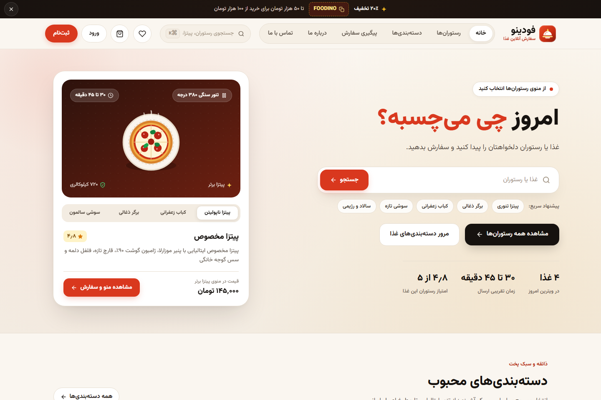
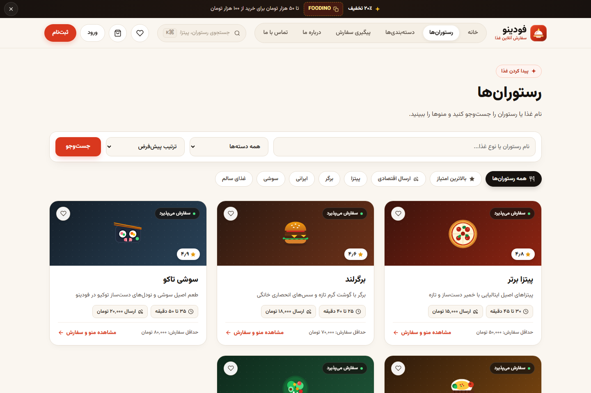
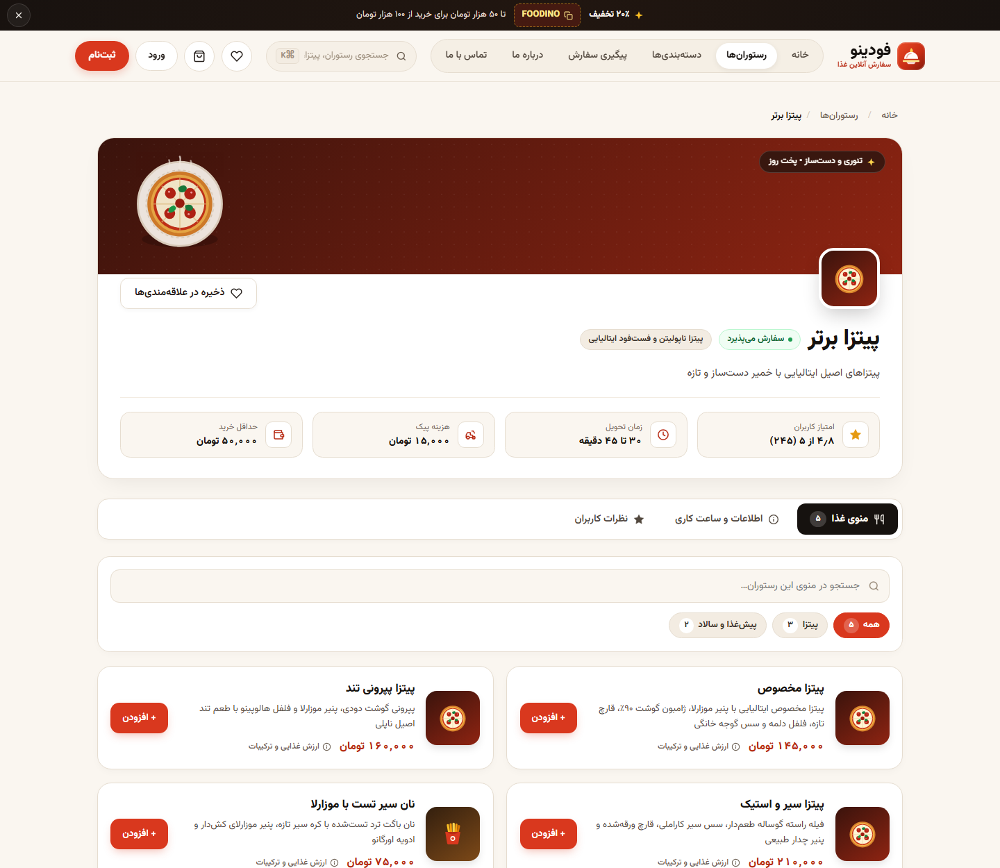
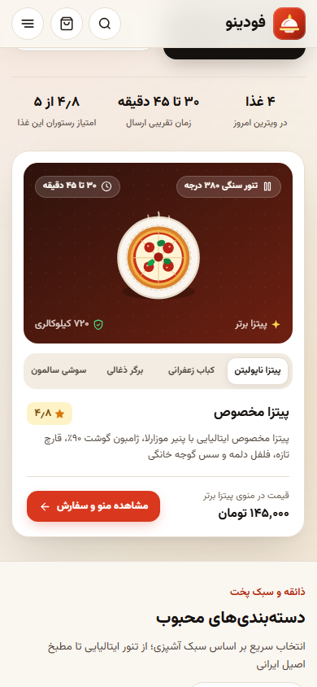
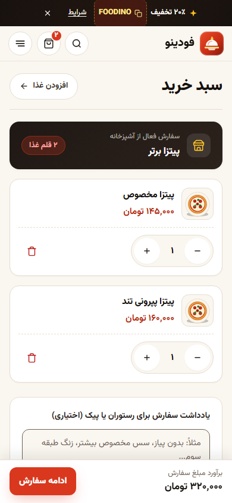
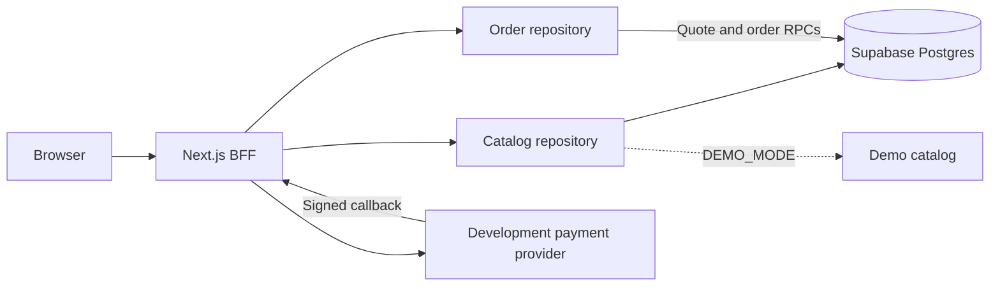

<p align="center">
  <a href="https://foodino-online-food-ordering-platfo-kohl.vercel.app/">
    
  </a>
</p>

<h1 align="center">فودینو | Foodino</h1>

<p align="center">
  <strong>غذای دلخواهت را پیدا کن، سفارش بده و تا رسیدنش پیگیری کن.</strong>
</p>

<p align="center">
  <a href="https://foodino-online-food-ordering-platfo-kohl.vercel.app/">
    
  </a>
</p>

<p align="center">
  <a href="https://nextjs.org/">
    
  </a>
  <a href="https://www.typescriptlang.org/">
    
  </a>
</p>

<p align="center">
  <a href="README.en.md">English</a> · <a href="#quickstart">راه‌اندازی</a> · <a href="#architecture">معماری</a>
</p>



## تجربهٔ سفارش

- **پیدا کردن غذا:** جست‌وجوی نام رستوران یا غذاهای منو، پیشنهادهای جست‌وجو، فیلتر دسته‌بندی و مرتب‌سازی بر اساس امتیاز یا هزینهٔ ارسال.
- **انتخاب از منو:** توضیح و قیمت غذا، گزینه‌ها و افزودنی‌ها، تعداد و یادداشت هر غذا؛ همراه با پنجرهٔ جزئیات قابل استفاده با کیبورد.
- **سبد خرید تک‌رستورانی:** نگه‌داری سبد در مرورگر، کنترل تعداد، یادداشت سفارش و کد تخفیف. غذای رستوران دوم تا خالی‌کردن سبد پذیرفته نمی‌شود.
- **حساب کاربری:** ورود و بازیابی رمز، نشانی‌های تحویل، سفارش‌های قبلی و رستوران‌های نشان‌شده. حذف علاقه‌مندی پس از ذخیرهٔ موفق تأیید می‌شود.
- **پیگیری سفارش:** دیدن مرحلهٔ آماده‌سازی و ارسال با کد رهگیری؛ توقف درخواست‌های تکراری برای سفارش ناموجود یا پایان‌یافته.
- **تعامل در موبایل و دسکتاپ:** ویترین تعاملی غذا، ورود بخش‌ها هنگام اسکرول، بازخورد هاور و لمس، فوکوس کیبورد و رعایت تنظیم کاهش حرکت.

### از نزدیک

<details>
<summary>فهرست رستوران‌ها و منوی سفارش</summary>

جست‌وجو و فیلتر رستوران‌ها:



صفحهٔ رستوران، جست‌وجوی منو و انتخاب غذا:



</details>

| ویترین غذا در موبایل | سبد خرید در موبایل |
| --- | --- |
|  |  |

<a id="quickstart"></a>

## راه‌اندازی

پیش‌نیاز مشترک: **Node.js 24.x** و **npm 11.x** مطابق [package.json](package.json). نسخهٔ بسته‌ها در [package-lock.json](package-lock.json) قفل شده است.

```bash
git clone https://github.com/Pezhm4n/Foodino---Online-Food-Ordering-Platform.git foodino
cd foodino
npm ci
```

### ۱. دیدن رابط بدون Docker

این مسیر برای بررسی کاتالوگ، جست‌وجو، ویترین و سبد خرید مناسب است. ورود، ثبت سفارش پایدار و پرداخت کامل به سرویس‌های واقعی نیاز دارند. در این حالت قیمت‌ها، نظرها و اطلاعات تغذیه، دادهٔ نمونه‌اند.

اگر از قبل `.env.local` دارید، آن را با دستور کپی جایگزین نکنید؛ تنظیمات لازم را از [.env.example](.env.example) تطبیق دهید.

**PowerShell**، از ریشهٔ مخزن:

```powershell
Copy-Item .env.example .env.local
$env:DEMO_MODE = "true"
npm run dev
```

**Bash / zsh**:

```bash
cp .env.example .env.local
DEMO_MODE=true npm run dev
```

در `http://127.0.0.1:3000` عبارت «پپرونی» را جست‌وجو کنید، منوی رستوران را باز کنید و یک غذا به سبد بیفزایید. برای توقف، `Ctrl+C` بزنید. در PowerShell، پیش از رفتن به حالت کامل، متغیر همین نشست را با `Remove-Item Env:DEMO_MODE` پاک کنید.

### ۲. اجرای کامل با Supabase محلی

**Docker Desktop** باید نصب و روشن باشد. Supabase CLI از وابستگی‌های توسعهٔ همین پروژه اجرا می‌شود. مقدار `DEMO_MODE` در `.env.local` را `false` نگه دارید و سپس اجرا کنید:

```bash
npm run db:start
npm run dev:local
```

اسکریپت `dev:local` نشانی و کلیدهای Supabase محلی را از CLI می‌گیرد و به فرایند Next.js می‌دهد. در حالت غیرنمایشی، قبل از اجرای سرور دسترسی به Data API را هم بررسی می‌کند.

| سرویس | نشانی پیش‌فرض |
| --- | --- |
| برنامه | `http://127.0.0.1:3000` |
| Supabase Studio | `http://localhost:54323` |
| ایمیل‌های آزمایشی | `http://localhost:54324` |
| Supabase API | `http://127.0.0.1:54321` |
| PostgreSQL 17 | `127.0.0.1:54322` |

برای امتحان جریان کامل، یک حساب بسازید، ایمیل تأیید را در سرویس ایمیل محلی باز کنید، نشانی تحویل ثبت کنید و سفارش را از درگاه توسعه ادامه دهید. این درگاه پول واقعی جابه‌جا نمی‌کند.

توقف Next.js با `Ctrl+C` انجام می‌شود. برای توقف سرویس‌های محلی، بدون حذف داده‌ها:

```bash
npx supabase stop --project-id foodino
```

اگر کانتینرها روشن‌اند ولی Data API پاسخ نمی‌دهد، بعد از همین دستور دوباره `npm run db:start` را اجرا کنید. دستور `npm run db:reset` برای بازسازی عمدی دیتابیس است و **داده‌های محلی فعلی را پاک می‌کند**؛ بخشی از راه‌اندازی روزمره نیست.

## تنظیمات و مرزهای نسخهٔ فعلی

مقادیر نمونه در [.env.example](.env.example) و قواعد واقعی در [اعتبارسنجی محیط](src/lib/validation/env.ts) قرار دارند. کلیدهای محرمانه را فقط در محیط سرور نگه دارید؛ فایل‌های `.env` وارد گیت نمی‌شوند.

| متغیر | کاربرد |
| --- | --- |
| `APP_URL` | مبدأ برنامه و نشانی بازگشت پرداخت |
| `SUPABASE_URL` | نشانی Supabase محلی یا ابری |
| `SUPABASE_PUBLISHABLE_KEY` | کلید عمومی پروژه؛ در این معماری در سرور استفاده می‌شود |
| `SUPABASE_SECRET_KEY` | کلید محرمانهٔ عملیات مدیریتی سرور |
| `DEMO_MODE` | مقدار `true` برای کاتالوگ نمایشی؛ حساب و سفارش پایدار را شبیه‌سازی نمی‌کند |
| `PAYMENT_PROVIDER` | فقط `development` یا `disabled` |
| `PAYMENT_CALLBACK_SECRET` | راز امضای پرداخت توسعه، حداقل ۳۲ نویسه |
| `RATE_LIMIT_ADAPTER` | `vercel` یا `trusted-reverse-proxy` متناسب با استقرار |
| `TRUSTED_PROXY_HOPS` | تعداد لایه‌های پروکسی مورد اعتماد، از ۱ تا ۱۰ |
| `SMTP_CONFIGURED` | اعلام آماده‌بودن SMTP؛ این پرچم به‌تنهایی سرویس ایمیل را تنظیم نمی‌کند |

**پرداخت:** پیاده‌سازی فعلی، درگاه توسعه با بازگشت امضاشده است. اتصال به درگاه بانکی واقعی در این مخزن وجود ندارد. کارخانهٔ درگاه در محیط production پرداخت توسعه را ارائه نمی‌دهد؛ انتشار سایت با فعال‌بودن سفارش و پرداخت واقعی دو موضوع جدا هستند.

**پیگیری:** وضعیت سفارش با درخواست‌های دوره‌ای خوانده می‌شود، نه با موقعیت زندهٔ پیک روی نقشه. در نبود اتصال، فاصلهٔ تلاش دوباره افزایش می‌یابد و در تب مخفی درخواست‌ها متوقف می‌شوند.

**تماس:** فرم صفحهٔ تماس، متن را در برنامهٔ ایمیل کاربر باز می‌کند؛ سامانهٔ ثبت تیکت نیست. موقعیت نقشه صریحاً نمونه است.

<a id="architecture"></a>

## معماری و قراردادهای اصلی

مرورگر با Next.js ارتباط دارد؛ دسترسی Supabase پشت Server Components، Server Actions و Route Handlers نگه داشته شده است. کاتالوگ عمومی، عملیات حساب و عملیات مدیریتی کلاینت‌های سروری جدا دارند.



- **مبلغ نهایی از سرور می‌آید.** مبلغ، تخفیف و هزینهٔ ارسال هنگام quote و ایجاد سفارش در سرور بررسی می‌شوند. مبلغ نهایی ارسالی مرورگر مرجع نیست.
- **ریال برای محاسبه، تومان برای نمایش.** مبالغ مالی با عدد صحیح ریال نگه‌داری می‌شوند؛ رابط، تومان نشان می‌دهد. سفارش از قیمت‌ها و مشخصات زمان خرید snapshot می‌گیرد.
- **سبد تک‌رستورانی یک قانون دامنه است.** فقط محدودیت ظاهری صفحهٔ سبد نیست و در مسیر ایجاد سفارش هم اعتبارسنجی می‌شود.
- **حساب و مجوز در چند لایه بررسی می‌شوند.** نشست با کوکی‌های `HttpOnly`، بررسی مبدأ درخواست و سیاست‌های RLS همراه است؛ عملیات اپراتور نقش جداگانه می‌خواهد.
- **دادهٔ نمونه جای خطای دیتابیس را نمی‌گیرد.** مخزن کاتالوگ فقط با `DEMO_MODE=true` سراغ دادهٔ نمایشی می‌رود.

| مسیر | مسئولیت |
| --- | --- |
| [`src/domain`](src/domain) | پول، قیمت‌گذاری، سبد و انتقال وضعیت سفارش |
| [`src/application`](src/application) | قرارداد مخزن‌ها، صفحه‌بندی و رابط درگاه پرداخت |
| [`src/infrastructure`](src/infrastructure) | Supabase، کاتالوگ نمایشی، پرداخت توسعه و زیرساخت HTTP |
| [`src/app`](src/app) | صفحه‌ها، Server Actions و APIهای BFF |
| [`src/components`](src/components) | رابط، منو، کارت‌ها و آرت‌ورک برداری |
| [`src/styles`](src/styles) | تم مشترک، استایل پایه و توکن‌های حرکت |
| [`supabase`](supabase) | پیکربندی، migrationها، seed و آزمون‌های دیتابیس |

پشتهٔ فعلی: **Next.js 16.3.4، React 19.2.8، TypeScript 5.9، styled-components 6.5**، فونت محلی وزیرمتن و Supabase با PostgreSQL 17. استایل‌های سرور از [SSR Registry](src/styles/StyledComponentsRegistry.tsx) عبور می‌کنند.

### دسترسی اپراتور

مسیر `/operator/orders` صف سفارش و تغییر وضعیت را برای نقش `operator` نمایش می‌دهد. در محیط محلی ابتدا حساب بسازید؛ سپس در ابزار مدیریتی مورد اعتماد Supabase، مقدار `role: "operator"` را به `raw_app_meta_data` همان حساب در `auth.users` اضافه کنید و سایر کلیدها را نگه دارید. دوباره وارد شوید تا claim جدید دریافت شود. نقش از `app_metadata` نشست خوانده می‌شود، نه از اطلاعات قابل ویرایش پروفایل.

## بررسی و توسعه

| دستور | چه چیزی را بررسی یا اجرا می‌کند؟ |
| --- | --- |
| `npm run lint` | ESLint |
| `npm run typecheck` | TypeScript بدون ساخت خروجی |
| `npm test` | آزمون‌های Vitest برای دامنه و ماژول‌های مرتبط |
| `npm run test:coverage` | آزمون‌ها همراه با گزارش پوشش |
| `npm run db:types:check` | هم‌خوانی تایپ‌های تولیدشده با دیتابیس محلی |
| `npm run db:test` | آزمون‌های pgTAP روی Supabase محلی |
| `npm run test:e2e` | آزمون‌های مرورگر با Playwright |
| `npm run build:local` | ساخت production با تنظیمات Supabase محلی |

برای تست مرورگر، ابتدا `npx playwright install chromium` را اجرا کنید. تنظیمات [Playwright](playwright.config.ts) از سرور موجود استفاده می‌کند یا سرور production روی پورت ۳۰۰۰ را از build موجود بالا می‌آورد؛ برای پوشش حساب و checkout، Supabase محلی و داده‌های سازگار لازم‌اند. اجرای همهٔ تست‌های مرورگر روی حالت صرفاً نمایشی کافی نیست.

تعریف بررسی‌های CI در [گردش‌کار پروژه](.github/workflows/ci.yml) است. تغییر قیمت‌گذاری یا ایجاد سفارش را همراه با آزمون‌های دامنه و دیتابیس بررسی کنید؛ نتیجهٔ تست واحد به‌تنهایی تأیید پرداخت واقعی نیست.

## تصمیم‌ها و مستندات بیشتر

- [BFF و دسترسی سروری Supabase](docs/adr/0001-supabase-server-only-bff.md)
- [SSR برای styled-components](docs/adr/0002-styled-components-ssr.md)
- [قانون سبد تک‌رستورانی](docs/adr/0003-single-restaurant-cart.md)
- [ریال، تومان و snapshot قیمت](docs/adr/0004-money-irr-integer-pricing.md)
- [مرز پرداخت توسعه و production](docs/adr/0005-fail-closed-payment-adapter.md)
- [فارسی و RTL در نسخهٔ اول](docs/adr/0006-persian-only-v1-rtl.md)
- [گزارش پایهٔ بررسی امنیت](docs/security/security-review-2026-09-01.md) و [ممیزی اولیه](docs/audits/baseline-2026-09-01.md)، مربوط به تاریخ درج‌شده در هر گزارش.

این مخزن در حال حاضر فایل مستقل `LICENSE` ندارد.
